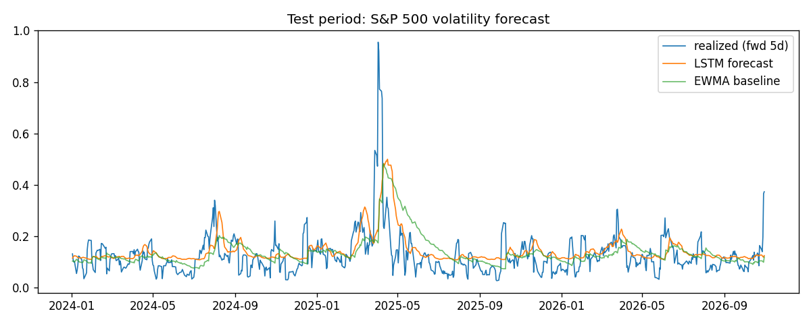

# Predicting how jumpy the stock market will be

This project trains a neural network to forecast the **volatility** of the
S&P 500 - that is, how wildly the index is likely to swing over the next
five days, not which direction it will go.

Why volatility? It is one of the core numbers in finance. Options prices,
risk limits, and margin requirements all depend on how jumpy the market is
expected to be. A bank does not just want to know "up or down" - it wants
to know "calm or stormy".

One honest thing to say up front: **this model predicts the size of future
swings, not their direction.** It cannot tell you whether to buy or sell,
and nothing here is trading advice. It reads patterns in past prices and
estimates how bumpy the next week is likely to be.

## What it actually does

- Downloads about 15 years of daily S&P 500 prices (the file is saved in
  the repo, so everything runs offline).
- Turns raw prices into simple summary numbers a person could compute too:
  recent daily moves, how much prices moved over the last 5/10/21 days, and
  how wide each day's high-to-low range was.
- Feeds those summaries into an LSTM - a type of neural network designed
  for sequences - which outputs a single number: expected volatility over
  the next five trading days.
- Trains with a custom error measure called QLIKE, which comes from the
  econometrics literature (Patton, 2011) and is designed specifically for
  judging volatility forecasts. Standard off-the-shelf error measures can
  rank volatility models incorrectly; QLIKE is the published fix. Writing
  this custom loss into PyTorch was a core part of the project.
- Logs every training run with MLflow so experiments can be compared, and
  shows the results in a small Streamlit dashboard.

## How well it does

Tested only on data the model never saw during training (2024 onward),
against two standard baselines - a simple 21-day rolling average and EWMA,
the RiskMetrics model that has been an industry default for decades:

| Model | RMSE | MAE | QLIKE |
|---|---|---|---|
| LSTM (custom QLIKE loss) | 0.0817 | 0.0524 | 0.447 |
| EWMA (RiskMetrics) | 0.0894 | 0.0580 | 0.602 |
| Naive 21-day rolling | 0.0933 | 0.0580 | 0.684 |

Lower is better on all three measures, and the LSTM beats both baselines on
all three. RMSE is the typical size of the forecast error: roughly speaking,
the LSTM's error is about 13% smaller than the naive baseline's.

An honest caveat: beating baselines on one index over one test period shows
the approach works on this data. It does not prove it would beat a trading
desk's models, and it says nothing about predicting prices.



## Run it

```bash
pip install -r requirements.txt
python train.py          # trains, evaluates, logs to MLflow
mlflow ui --backend-store-uri sqlite:///mlflow.db   # experiment logs
streamlit run app.py     # results dashboard
```

## Layout

- `data.py` - downloads and caches S&P 500 daily prices
- `features.py` - builds the summary inputs from raw prices
- `model.py` - the LSTM
- `losses.py` - the custom QLIKE loss and a weighted MSE variant
- `baselines.py` - the rolling and EWMA baselines
- `train.py` - training + evaluation + MLflow logging
- `app.py` - Streamlit dashboard
- `results/metrics.json` - the exact numbers from the reported run
